<picture>
  <source media="(prefers-color-scheme: dark)" srcset="./dark.svg">
  <source media="(prefers-color-scheme: light)" srcset="./light.svg">
  
</picture>

<h1 align="center">Abdenasser Farkli</h1>

<a href="https://www.linkedin.com/in/abdenasser-farkli/">LinkedIn</a> · <a href="#selected-projects">Explore my projects</a>

## About me

I’m a software development student at YouCode (UM6P) in Morocco. I build responsive web interfaces with JavaScript and connect them to REST APIs. My projects cover form validation, loading and error states, and team collaboration with Git and GitHub. I also build C++ console apps to strengthen my programming fundamentals.

## Selected projects

| Project | What I built | Tech stack |
| --- | --- | --- |
| [**Carnet de recettes**](https://github.com/AbdenasserFarkli/recipe-notebook) | Recipe search, validated forms, and a recipe list with loading, empty, and error states. | JavaScript · Axios · DummyJSON |
| [**Nour Academy**](https://github.com/AbdenasserFarkli/Nour--Academy-Project) | Team project for course registration, with filters by level, subject, and center, plus a cart with a monthly total. | JavaScript · Tailwind CSS · Vite |
| [**Application météo**](https://github.com/AbdenasserFarkli/Application-m-t-o) | City search with suggestions, current conditions, daily forecasts, and a retry action. | JavaScript · Open-Meteo · Vite |
| [**Thimdrine**](https://github.com/AbdenasserFarkli/-Project-Thimdrine) | A multi-page website presenting a cooperative in Nador and its local products. | HTML · CSS |
| [**Bank Management System**](https://github.com/AbdenasserFarkli/Project-bank-conole-c-) | A console app for managing clients and users, with permissions and file storage. | C++ |

## Current skills

| Area | Tools and techniques I use |
| --- | --- |
| Front end | HTML, CSS, Tailwind CSS, JavaScript, DOM events, responsive layouts |
| APIs | Fetch, Axios, REST APIs, async/await, loading and error states |
| Programming fundamentals | C++, structs, vectors, file I/O |
| Project workflow | Git, GitHub, Vite, Jira |
